[English](README.en.md) | **简体中文**

<picture>
  <source media="(max-width: 640px) and (prefers-color-scheme: dark)" srcset="assets/presentation/hero-mobile-dark.svg">
  <source media="(max-width: 640px)" srcset="assets/presentation/hero-mobile-light.svg">
  <source media="(prefers-color-scheme: dark)" srcset="assets/presentation/hero-dark.svg">
  
</picture>

**为每个 span 输出 proceed、abstain 或 handoff，保留探针证据与判定理由。**

`v0.9.0` · `Python 3.10+` · [MIT](LICENSE)

[Website](https://probegate.lei6393.com) · [Demo record](docs/demo-results.json)

## 为什么使用

一个步骤可能语法错误却自信，也可能只是模型表达犹豫。ProbeGate 把不确定度和可执行检查拆成两个信号，明确展示当前策略如何处理它们，方便 Agent 调用方决定继续、标记或请求人工。

## 架构

<picture>
  <source media="(max-width: 640px) and (prefers-color-scheme: dark)" srcset="assets/presentation/architecture-mobile-dark.svg">
  <source media="(max-width: 640px)" srcset="assets/presentation/architecture-mobile-light.svg">
  <source media="(prefers-color-scheme: dark)" srcset="assets/presentation/architecture-dark.svg">
   threshold 且探针失败时 handoff；单信号触发为 abstain，双清为 proceed。返回值本身不停止调用方的 Agent。">
</picture>

guard/guard_async 读取或从端点获取 uncertainty，调用所选 Probe，然后构造 GateDecision。仅当 uncertainty > threshold 且探针失败时 handoff；单信号触发为 abstain，双清为 proceed。返回值本身不停止调用方的 Agent。

源码入口：[probegate/gate.py](probegate/gate.py) · [probegate/models.py](probegate/models.py) · [probegate/uncertainty.py](probegate/uncertainty.py) · [probegate/probes/compile_probe.py](probegate/probes/compile_probe.py) · [probegate/probes/test_probe.py](probegate/probes/test_probe.py) · [probegate/probes/lint_probe.py](probegate/probes/lint_probe.py) · [probegate/probes/schema_probe.py](probegate/probes/schema_probe.py) · [probegate/cli.py](probegate/cli.py)

## 安装

包支持 Python 3.10+；以下使用 Python 3.12 与 uv。演示不加载端点凭证，也不调用模型。

```bash
git clone https://github.com/SuperMarioYL/probegate.git
cd probegate
uv venv --python 3.12
uv pip install --python .venv/bin/python -e .
```

## 快速开始

四个合成 span 显式给定 0.1/0.9 不确定度和有效/无效 Python，执行真实 compile 探针并检查 AND 判定。不是实际模型置信校准实验。

```bash
.venv/bin/python examples/presentation-demo.py
```

完整输入与执行步骤见上方命令及 [Demo 记录](docs/demo-results.json)。

## 使用

```bash
.venv/bin/probegate init
.venv/bin/probegate gate --demo --probe compile
.venv/bin/probegate ui --port 8000
```
自己的 JSONL 每行可写 `{"id":"s1","agent_step":1,"content":"answer = 42","uncertainty":0.1}`，再用 `gate --fake-spans spans.jsonl`。异步 Agent 应 `await gate.guard_async(span)`；调用方必须显式处理 handoff。

## 实际 Demo

<picture>
  <source media="(max-width: 640px) and (prefers-color-scheme: dark)" srcset="assets/presentation/process-mobile-dark.svg">
  <source media="(max-width: 640px)" srcset="assets/presentation/process-mobile-light.svg">
  <source media="(prefers-color-scheme: dark)" srcset="assets/presentation/process-dark.svg">
  
</picture>

### 检查所有信号组合

只有高不确定度且语法失败的组合进入 handoff。

```text
$ .venv/bin/python examples/presentation-demo.py
[
  {
    "case": "clear",
    "uncertainty": 0.1,
    "probe_passed": true,
    "rule": "proceed"
  },
  {
    "case": "uncertain",
    "uncertainty": 0.9,
    "probe_passed": true,
    "rule": "abstain"
  },
  {
    "case": "syntax_only",
    "uncertainty": 0.1,
    "probe_passed": false,
    "rule": "abstain"
  },
  {
    "case": "both",
    "uncertainty": 0.9,
    "probe_passed": false,
    "rule": "handoff"
  }
]
```

## 能力与接入

<picture>
  <source media="(max-width: 640px) and (prefers-color-scheme: dark)" srcset="assets/presentation/integrations-mobile-dark.svg">
  <source media="(max-width: 640px)" srcset="assets/presentation/integrations-mobile-light.svg">
  <source media="(prefers-color-scheme: dark)" srcset="assets/presentation/integrations-dark.svg">
  
</picture>

CLI 和 Python API 使用同一套决策模型，UI 可展示逐 span 决策。compile 只做 Python 编译而不运行代码；其他探针有各自输入契约，应在接入前阅读对应模块。


## 配置

`.probegate.toml` 管理 uncertainty_threshold、probe、model_target、handoff_mode、api_key 与 base_url。默认 threshold=0.5，probe=compile。提供 key 与 URL 后可获取 logprob 信号；获取失败会回退自报值并在理由中注明降级。

## 路线图与范围

当前包含四种探针、异步入口、端点获取与本地 UI。团队身份、托管中继和更广泛的校准实验仍是后续方向。

- 低不确定度且探针失败只会 abstain，不会自动 handoff；该 AND 策略不保证拦下所有错误。
- 通过语法检查不代表程序正确，logprob 或自报值也不等于已校准的正确概率。

 · [Recording script](docs/demo.tape)

## 许可证

[MIT](LICENSE)
